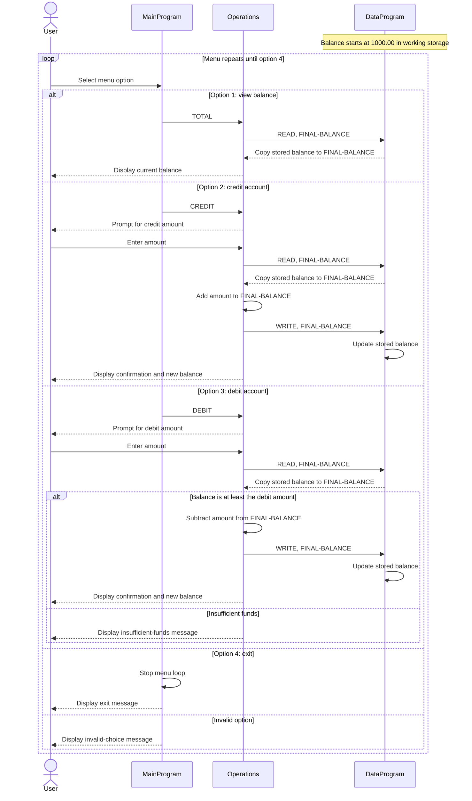

# Student Account Program

This COBOL program provides a simple menu-driven account balance manager. It
supports viewing a balance, crediting the account, and debiting the account.
Although it can serve as a student-account exercise, the current program does
not store student names, IDs, or separate balances for multiple students.

## Source Files

- [`main.cob`](../src/cobol/main.cob) defines `MainProgram`, displays the menu,
  accepts the user's choice, and dispatches the selected action to
  `Operations`. Choosing option 4 ends the program; other unrecognized choices
  display an error and return to the menu.
- [`operations.cob`](../src/cobol/operations.cob) defines `Operations` and
  implements balance viewing, credits, and debits. It prompts for an amount,
  calls `DataProgram` to read or save the balance, and displays the result.
  `TOTAL ` requests the balance, `CREDIT` adds an amount, and `DEBIT ` attempts
  to subtract an amount.
- [`data.cob`](../src/cobol/data.cob) defines `DataProgram`, the storage
  interface used by `Operations`. `READ` copies the stored balance to the
  caller, and `WRITE` updates it. The stored balance starts at `1000.00`.

## Account Rules

- The program manages one balance, initialized to `1000.00` when the program
  starts.
- A credit adds the entered amount to the balance and saves the result.
- A debit is allowed when the amount is less than or equal to the balance. If
  it is greater, the program displays an insufficient-funds message and leaves
  the balance unchanged. The account cannot be overdrawn through this check.
- Balances and amounts use a COBOL numeric field with six integer digits and
  two decimal places (`PIC 9(6)V99`).
- There is no explicit validation of entered transaction amounts beyond their
  numeric field representation. In particular, the program does not enforce a
  positive-amount rule.
- The balance is held in working storage, not saved to a file or database. It
  resets to `1000.00` on each program run, and there is no account selection or
  per-student data.

## Data Flow

